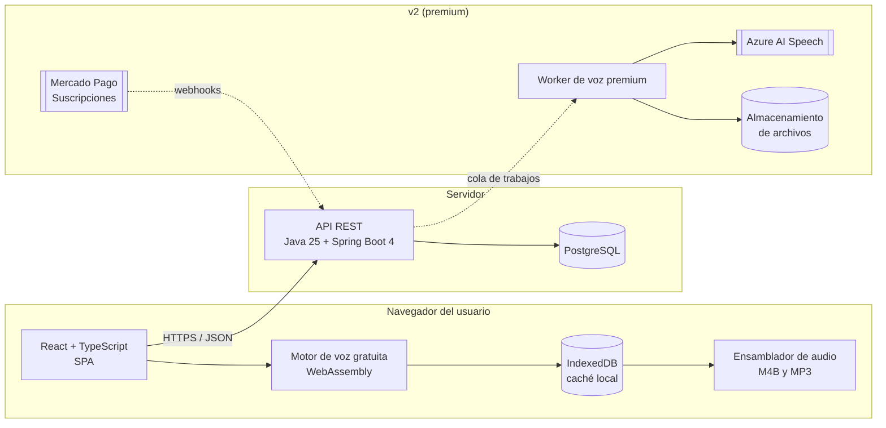
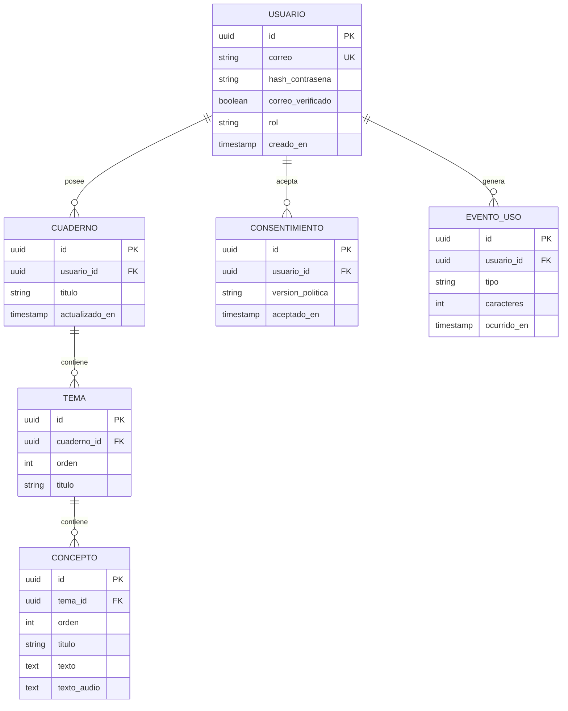

# Alcance y especificación de requisitos

**Proyecto:** Podcuaderno
**Documento:** Especificación de requisitos de software (basada en ISO/IEC/IEEE 29148)
**Versión:** 0.3 (borrador)
**Fecha:** 25 de noviembre de 2026
**Autor:** Sebastián

---

## 1. Introducción

### 1.1 Propósito

Este documento define qué debe hacer Podcuaderno, con qué calidad y qué queda por fuera. Es la referencia para el backlog, el diseño, las pruebas y la aceptación de cada versión.

### 1.2 Definiciones

| Término | Significado en este proyecto |
|---|---|
| Cuaderno | Conjunto de apuntes de un usuario sobre una materia. Se convierte en un audiolibro. |
| Tema | División principal de un cuaderno. Equivale a un capítulo del audiolibro. |
| Concepto | Unidad dentro de un tema, con título y texto. Tiene su propio marcador en el audiolibro. |
| Texto para audio | Versión opcional del texto de un concepto, adaptada para escucharse (sin símbolos ni código). |
| Voz gratuita | Voz sintetizada en el navegador del usuario con un modelo de código abierto. |
| Voz premium | Voz neuronal sintetizada en el servidor con un proveedor comercial (v2). |
| Modo invitado | Uso sin cuenta; el contenido vive solo en el navegador. |
| M4B | Formato de audiolibro que admite marcadores de capítulo. |

### 1.3 Referencias

- 01_Formulacion_y_Constitucion.md
- Ley 1581 de 2012 (protección de datos personales, Colombia).
- OWASP Top 10:2025.
- WCAG 2.1 (accesibilidad web).

## 2. Alcance

### 2.1 Dentro del alcance de la v1.0 (MVP gratuito)

1. Registro, inicio de sesión, recuperación de contraseña y eliminación de cuenta.
2. Cuadernos: crear, listar, renombrar y eliminar.
3. Importar apuntes en TXT, Markdown y Word (DOCX); detectar temas y conceptos.
4. Editor para corregir la estructura y el texto.
5. Voz gratuita en el navegador, con progreso, cancelación y reanudación.
6. Exportar M4B con marcadores y MP3 por tema.
7. Modo invitado.
8. Panel de métricas para el administrador y política de tratamiento de datos.

### 2.2 Versiones posteriores (fuera de la v1.0)

- **v2:** voz premium en el servidor, planes con suscripción mensual en Mercado Pago, límites de uso por plan, almacenamiento de audiolibros premium.
- **v3:** podcast privado por usuario, compartir cuadernos por enlace, importación de PDF, otros idiomas.

### 2.3 Fuera del alcance del proyecto

- Aplicación móvil nativa (la web es responsive y funciona en el celular).
- Generar o resumir contenido con IA.
- Edición colaborativa en tiempo real.
- Voces clonadas o personalizadas.

## 3. Descripción general

### 3.1 Usuarios

| Usuario | Descripción | Necesidad principal |
|---|---|---|
| Estudiante invitado | Prueba la aplicación sin registrarse. | Obtener un audiolibro rápido, sin crear cuenta. |
| Estudiante registrado | Usa la aplicación con frecuencia. | Guardar sus cuadernos y volver a generarlos cuando los actualiza. |
| Suscriptor premium (v2) | Paga por una voz de mejor calidad. | Voz natural y límites claros de uso. |
| Administrador | El autor. | Ver métricas de uso para decidir y detectar abusos. |

No se asume ningún conocimiento técnico en los usuarios estudiantes: todos los textos de la interfaz deben estar en español sencillo.

### 3.2 Arquitectura

Monolito modular: un solo backend desplegable, organizado en módulos de negocio, donde cada módulo aplica Clean Architecture con puertos y adaptadores (ADR-0001 y ADR-0002). Se descarta empezar con microservicios porque un equipo de una persona no se beneficia de su complejidad. El diseño detallado está en el documento **05_Arquitectura_y_Diseno**.

**Módulos del backend (v1.0):** `identity` (usuarios, autenticación), `notebooks` (cuadernos, temas, conceptos), `importing` (lectura de TXT, MD y DOCX y detección de estructura), `metrics` (eventos de uso agregados) y `shared` (núcleo compartido).
**Módulos v2:** `premiumvoice`, `subscriptions`.

### 3.3 Entorno de operación

- Navegadores: Chrome, Edge, Firefox y Safari en sus dos últimas versiones, de escritorio y móviles (iOS y Android).
- Servidor: contenedores Docker; PostgreSQL 16 o superior.
- Reproductores objetivo: BookPlayer y Apple Books (M4B); cualquier reproductor (MP3).

### 3.4 Restricciones de diseño

- En la versión gratuita, el texto de los apuntes **no se envía a ningún servicio de voz externo**: la voz se genera en el dispositivo.
- Los modelos de voz gratuitos deben tener una licencia que permita uso comercial, porque la aplicación tendrá un plan de pago.
- El proveedor de voz premium se accede mediante un puerto (interfaz); cambiarlo no debe afectar otros módulos.
- La API se versiona en la ruta (`/api/v1/...`) y se documenta con OpenAPI.

## 4. Requisitos funcionales

Prioridad MoSCoW: **M** obligatorio, **S** importante, **C** deseable. Versión: en qué entrega se construye.

### 4.1 Cuentas y privacidad

| ID | Requisito | Prioridad | Versión |
|---|---|---|---|
| RF-01 | El sistema debe permitir registrarse con correo y contraseña, verificar el correo, iniciar y cerrar sesión. | M | v1.0 |
| RF-02 | El sistema debe permitir recuperar la contraseña mediante un enlace enviado al correo, válido por 30 minutos y de un solo uso. | S | v1.0 |
| RF-03 | El sistema debe pedir la aceptación de la política de tratamiento de datos al registrarse y registrar la fecha y la versión aceptada. | M | v1.0 |
| RF-04 | El sistema debe permitir que el usuario elimine su cuenta y todos sus datos de forma definitiva. | M | v1.0 |

### 4.2 Cuadernos e importación

| ID | Requisito | Prioridad | Versión |
|---|---|---|---|
| RF-05 | El usuario debe poder crear, listar, renombrar y eliminar cuadernos. Solo el dueño puede ver y modificar un cuaderno. | M | v1.0 |
| RF-06 | El sistema debe importar texto pegado y archivos TXT y Markdown. | M | v1.0 |
| RF-07 | El sistema debe importar archivos Word (DOCX) y usar sus estilos de título (Título 1, Título 2) para detectar temas y conceptos. | M | v1.0 |
| RF-08 | Si el documento no tiene títulos, el sistema debe dividirlo por párrafos y proponer un título para cada concepto con sus primeras palabras. | S | v1.0 |
| RF-09 | El sistema debe importar PDF con texto seleccionable. | C | v3 |

### 4.3 Editor

| ID | Requisito | Prioridad | Versión |
|---|---|---|---|
| RF-10 | El usuario debe poder renombrar, reordenar (arrastrando), unir, dividir y eliminar temas y conceptos, y editar su texto. Los cambios se guardan automáticamente. | M | v1.0 |
| RF-11 | El usuario debe poder escribir un texto para audio por concepto, que reemplaza al texto original solo en el audio. | S | v1.0 |
| RF-12 | El usuario debe poder definir un diccionario de pronunciación propio (por ejemplo, "SQL" se lee "ese cu ele"). | C | v1.0 |

### 4.4 Voz gratuita y exportación

| ID | Requisito | Prioridad | Versión |
|---|---|---|---|
| RF-13 | El sistema debe generar la voz de cada concepto en el navegador, mostrar el progreso y permitir cancelar y reanudar sin perder lo ya generado. | M | v1.0 |
| RF-14 | El usuario debe poder elegir entre al menos dos voces gratuitas en español y ajustar la velocidad. | S | v1.0 |
| RF-15 | El usuario debe poder escuchar la vista previa de un concepto antes de generar todo el cuaderno. | S | v1.0 |
| RF-16 | El sistema debe exportar un M4B con un marcador por tema y por concepto, portada generada y metadatos (título del cuaderno, autor). | M | v1.0 |
| RF-17 | El sistema debe exportar un archivo ZIP con un MP3 por tema. | M | v1.0 |
| RF-18 | Un invitado debe poder importar, editar, generar y exportar sin cuenta; su contenido se guarda solo en su navegador y se le avisa que puede perderse. | S | v1.0 |

### 4.5 Administración

| ID | Requisito | Prioridad | Versión |
|---|---|---|---|
| RF-19 | El administrador debe ver métricas agregadas: usuarios registrados, usuarios activos, cuadernos creados, audiolibros generados y usuarios que generan más de uno. No debe poder ver el contenido de los apuntes. | M | v1.0 |

### 4.6 Premium y versiones posteriores

| ID | Requisito | Prioridad | Versión |
|---|---|---|---|
| RF-20 | El sistema debe generar la voz premium en el servidor mediante una cola de trabajos y avisar al usuario cuando termine. | M | v2 |
| RF-21 | El sistema debe ofrecer planes con suscripción mensual mediante Mercado Pago y activar o cancelar el plan según las notificaciones (webhooks) del proveedor. | M | v2 |
| RF-22 | El sistema debe aplicar el límite de caracteres premium de cada plan y mostrar al usuario cuánto ha usado. | M | v2 |
| RF-23 | El sistema debe guardar los audiolibros premium durante 30 días para descarga. | S | v2 |
| RF-24 | El usuario debe poder seguir sus cuadernos como un podcast privado (feed RSS con enlace secreto). | C | v3 |
| RF-25 | El usuario debe poder compartir un cuaderno mediante un enlace de solo lectura. | C | v3 |

## 5. Requisitos no funcionales

| ID | Categoría | Requisito | Cómo se verifica |
|---|---|---|---|
| RNF-01 | Seguridad | Contraseñas con hash bcrypt o Argon2; token de acceso JWT de corta duración (15 min) y refresh token en cookie `HttpOnly`, `Secure` y `SameSite`; HTTPS obligatorio; CORS limitado al dominio del frontend; límite de intentos de inicio de sesión; controles del OWASP Top 10:2025, en especial control de acceso por dueño del recurso. | Pruebas de seguridad automatizadas, OWASP ZAP, SonarQube. |
| RNF-02 | Privacidad | Cumplir la Ley 1581 de 2012: política de tratamiento publicada, consentimiento al registrarse, derecho a consultar y eliminar los datos. Los apuntes no se comparten con terceros. | Revisión del flujo de registro y de eliminación de cuenta. |
| RNF-03 | Costo | Operación de la v1.0 ≤ 10 USD al mes (propuesto). La voz gratuita no consume recursos del servidor. | Facturación del hosting. |
| RNF-04 | Rendimiento | API: percentil 95 < 300 ms en operaciones de cuadernos. Frontend: LCP < 2,5 s en conexión 4G. Generación de voz: ver OE-2. | k6 o JMeter para la API; Lighthouse para el frontend. |
| RNF-05 | Compatibilidad | Funciona en los navegadores de la sección 3.3. El M4B abre con marcadores en BookPlayer y Apple Books. | Pruebas manuales en iPhone y Android antes de cada versión. |
| RNF-06 | Usabilidad | Una persona sin conocimientos técnicos genera su primer audiolibro en < 5 minutos sin ayuda. Todos los mensajes en español sencillo. | Prueba con 5 usuarios. |
| RNF-07 | Accesibilidad | WCAG 2.1 nivel AA: contraste, navegación con teclado, etiquetas semánticas, textos alternativos. | Lighthouse ≥ 90 en Accesibilidad y revisión manual con lector de pantalla. |
| RNF-08 | Calidad de código | Backend: cobertura ≥ 80 % en servicios y dominio; Checkstyle o Spotless. Frontend: ESLint y pruebas de componentes clave con Vitest y Testing Library. Prueba E2E del flujo principal con Playwright. SonarQube sin problemas bloqueantes. | Pipeline de CI. |
| RNF-09 | Mantenibilidad | Clean Architecture con puertos y adaptadores en cada módulo, principios SOLID y estándares del documento 05; API documentada con OpenAPI; decisiones registradas en ADR. | Pruebas de arquitectura con ArchUnit y Spring Modulith en el pipeline; revisión de código con checklist. |
| RNF-10 | Disponibilidad | 99 % mensual durante la beta; respaldo diario de la base de datos con restauración probada. | Monitor de disponibilidad y prueba de restauración. |
| RNF-11 | Límites de entrada | Archivo importado ≤ 5 MB; cuaderno ≤ 200 000 caracteres en la v1.0. | Pruebas de validación. |
| RNF-12 | Observabilidad | Logs estructurados en JSON, métricas con Spring Boot Actuator y alertas de errores del servidor. | Panel de monitoreo. |
| RNF-13 | Portabilidad | Todo el sistema se levanta localmente con un solo `docker compose up`. | Prueba en un equipo limpio. |
| RNF-14 | Legal | Cada modelo de voz y cada librería usada tiene una licencia compatible con uso comercial. La licencia del código del proyecto se define en un ADR, considerando que habrá un plan de pago. | Inventario de licencias en `docs/licencias.md`. |

## 6. Decisiones técnicas iniciales

| Decisión | Alternativas | Motivo |
|---|---|---|
| Java 25 + Spring Boot 4 | Laravel, Node.js | Elección del patrocinador; alta demanda en backend empresarial; versión LTS con soporte largo. |
| React + TypeScript + Vite | Angular | Más demandado en trabajo remoto; ecosistema amplio para editores y audio. |
| PostgreSQL | MySQL, MongoDB | Datos relacionales (usuarios, cuadernos, temas, conceptos); transacciones; soporte JSON. |
| Monolito modular (ADR-0001) | Microservicios | Un solo desarrollador; menos complejidad operativa; se puede dividir más adelante. |
| Clean Architecture con puertos y adaptadores (ADR-0002) | Capas clásicas con entidades JPA como modelo | Negocio independiente de la tecnología y fácil de probar; costo de mappers aceptado. |
| Voz gratuita en el navegador (modelo de código abierto en WebAssembly) | Voz gratuita en el servidor | Costo de servidor 0 y privacidad. **Se valida en el Sprint 0** (calidad, velocidad en celular y licencia). |
| Ensamblado del audio en el navegador | Ensamblado en el servidor | Evita subir audio pesado al servidor. **Se valida en el Sprint 0.** |
| Apache POI para leer DOCX | Conversión en el navegador | Librería madura en Java; mantiene el procesamiento de archivos en el backend con validaciones. |
| JWT + refresh token en cookie | Sesiones en servidor | API sin estado, preparada para escalar; refresh en cookie `HttpOnly` reduce el riesgo de XSS. |
| Azure AI Speech (v2) | Google Cloud TTS | Voces neuronales en español de Colombia y SDK oficial para Java. |
| Mercado Pago Suscripciones (v2) | Stripe | Stripe no está disponible para empresas en Colombia; Mercado Pago acepta PSE y Efecty. |
| Hosting | Por definir | Se decide en un ADR en el Sprint 7 comparando costo, memoria para la JVM y respaldos. |

## 7. Modelo de datos inicial (v1.0)

El modelo usa los términos del negocio; en el código, las clases y tablas van en inglés (ADR-0005; ver el lenguaje ubicuo en el documento 05). `EVENTO_USO` guarda solo el tipo de evento (por ejemplo, "audiolibro generado") y la cantidad de caracteres, nunca el contenido. Es la base de las métricas de OE-5 y de los límites de la v2.

## 8. Trazabilidad

| Objetivo | Requisitos | Historias |
|---|---|---|
| OE-1 | RF-05 a RF-08, RF-10 a RF-12 | HU-06 a HU-09, HU-11 a HU-13 |
| OE-2 | RF-13 a RF-15 | HU-14, HU-16 a HU-18 |
| OE-3 | RF-16, RF-17, RNF-05 | HU-15, HU-19, HU-20 |
| OE-4 | RF-01 a RF-04, RNF-01, RNF-02 | HU-01 a HU-05, HU-26 |
| OE-5 | RF-18, RF-19, RNF-06 | HU-21, HU-22, HU-24, HU-29 |
| OE-6 | RNF-07 a RNF-13 | HU-23, HU-25, HU-27, HU-28, HU-30 |

## 9. Criterios de aceptación de la v1.0

1. Todos los requisitos **M** de la v1.0 están implementados y probados.
2. Al menos el 70 % de los requisitos **S** de la v1.0 están implementados.
3. Se cumplen RNF-01, RNF-02, RNF-05, RNF-06 y RNF-14 con evidencia.
4. La aplicación está en producción con HTTPS, respaldos y monitoreo.

## Historial de versiones

| Versión | Fecha | Cambio |
|---|---|---|
| 0.1 | 25 de noviembre de 2026 | Requisitos de la herramienta de línea de comandos. |
| 0.2 | 25 de noviembre de 2026 | Reescrito para la aplicación web freemium con Java + React. |
| 0.3 | 26 de noviembre de 2026 | Arquitectura definida: Clean Architecture por módulo, nombres de módulos en inglés, RNF-09 con verificación automática. |
