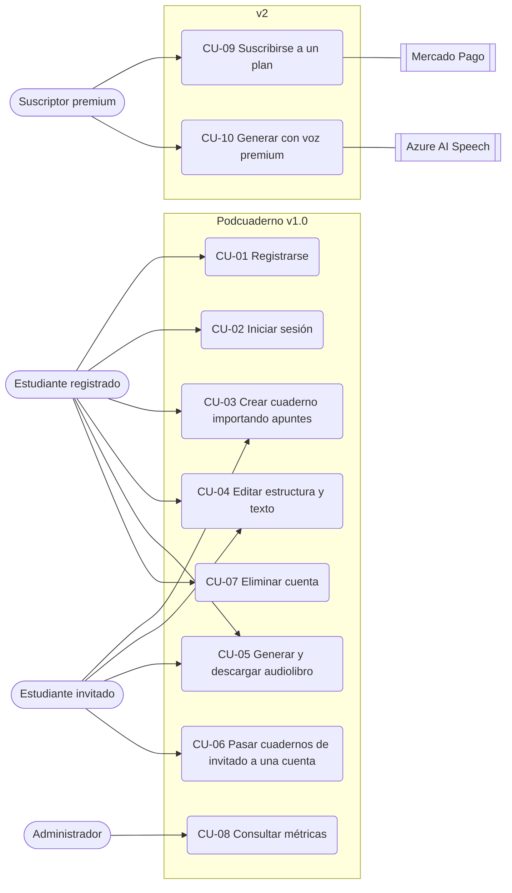

# Backlog, historias de usuario y casos de uso

**Proyecto:** Podcuaderno
**Versión:** 0.4 (borrador)
**Fecha:** 26 de noviembre de 2026
**Autor:** Sebastián

---

## 1. Cómo leer este documento

- Las **épicas** agrupan historias por objetivo.
- Cada **historia de usuario (HU)** tiene prioridad MoSCoW, estimación en puntos de historia (Fibonacci), requisitos relacionados y criterios de aceptación en formato Dado / Cuando / Entonces.
- Los **casos de uso (CU)** describen la interacción completa de un actor con el sistema.
- El backlog vivo está en **GitHub Projects**: cada HU es un issue con etiquetas de épica, prioridad, puntos y versión. Este documento es la línea base.
- Se detallan las historias de la **v1.0**. Las de la v2 y la v3 quedan como épicas sin estimar, porque se planifican con los datos de la beta.

## 2. Épicas

| ID | Épica | Versión | Historias |
|---|---|---|---|
| EP-01 | Cuentas y privacidad | v1.0 | HU-01 a HU-05 |
| EP-02 | Cuadernos e importación | v1.0 | HU-06 a HU-09 |
| EP-03 | Editor | v1.0 | HU-11 a HU-13 |
| EP-04 | Voz gratuita y exportación | v1.0 | HU-14 a HU-20 |
| EP-05 | Experiencia y validación | v1.0 | HU-21 a HU-24 |
| EP-06 | Plataforma, calidad y despliegue | v1.0 | HU-25 a HU-30 |
| EP-07 | Voz premium | v2 | Por detallar (RF-20, RF-23) |
| EP-08 | Planes y suscripciones | v2 | Por detallar (RF-21, RF-22) |
| EP-09 | Podcast privado, compartir y PDF | v3 | Por detallar (RF-09, RF-24, RF-25); el ID HU-10 queda reservado para importar PDF |

## 3. Historias de usuario de la v1.0

### EP-01 · Cuentas y privacidad

**HU-01 · Registrarme** · M · 5 pts · RF-01, RF-03
> Como **estudiante**, quiero crear una cuenta con mi correo, para guardar mis cuadernos.

- Dado un correo nuevo y una contraseña de al menos 8 caracteres, cuando me registro y acepto la política de datos, entonces recibo un correo de verificación y mi cuenta queda pendiente.
- Dado un correo ya registrado, cuando intento registrarme, entonces veo un mensaje genérico que no revela si el correo existe.
- Dado que no acepto la política de datos, cuando intento registrarme, entonces el botón de registro está deshabilitado.

**HU-02 · Iniciar y cerrar sesión** · M · 5 pts · RF-01, RNF-01
> Como **estudiante**, quiero iniciar sesión de forma segura, para acceder a mis cuadernos desde cualquier dispositivo.

- Dadas credenciales válidas y el correo verificado, cuando inicio sesión, entonces recibo un token de acceso de 15 minutos y un refresh token en cookie `HttpOnly`.
- Dado que mi token de acceso expira, cuando hago una petición, entonces se renueva automáticamente sin que yo lo note.
- Dados 5 intentos fallidos en 15 minutos, cuando intento de nuevo, entonces recibo un error 429 y debo esperar.
- Cuando cierro sesión, entonces el refresh token queda invalidado en el servidor.

**HU-03 · Recuperar mi contraseña** · S · 3 pts · RF-02
> Como **estudiante**, quiero recuperar mi contraseña si la olvido, para no perder mis cuadernos.

- Cuando pido recuperar la contraseña, entonces recibo un enlace válido por 30 minutos y de un solo uso.
- Dado un enlace usado o vencido, cuando lo abro, entonces veo un mensaje claro y la opción de pedir otro.

**HU-04 · Eliminar mi cuenta** · M · 2 pts · RF-04, RNF-02
> Como **estudiante**, quiero eliminar mi cuenta y todos mis datos, para ejercer mi derecho sobre mi información.

- Cuando confirmo la eliminación escribiendo mi correo, entonces se borran mi usuario, mis cuadernos y mis consentimientos, y se cierra mi sesión.
- Después de eliminarla, ese correo puede volver a registrarse como cuenta nueva.

**HU-05 · Política de tratamiento de datos** · M · 2 pts · RF-03, RNF-02
> Como **estudiante**, quiero saber qué se hace con mis datos, para decidir si uso la aplicación.

- La política está publicada en una página accesible sin iniciar sesión.
- Cada aceptación queda registrada con la versión de la política y la fecha.

### EP-02 · Cuadernos e importación

**HU-06 · Gestionar mis cuadernos** · M · 5 pts · RF-05, RNF-01
> Como **estudiante registrado**, quiero crear, ver, renombrar y eliminar cuadernos, para organizar mis materias.

- Cuando creo un cuaderno, entonces aparece en mi lista ordenada por última modificación.
- Dado un cuaderno de otro usuario, cuando intento acceder a su ID por la API, entonces recibo 404 (no 403, para no revelar que existe).
- Cuando elimino un cuaderno, entonces se pide confirmación y se borran sus temas y conceptos.

**HU-07 · Importar texto, TXT y Markdown** · M · 5 pts · RF-06
> Como **estudiante**, quiero pegar mis apuntes o subir un archivo de texto, para no tener que copiarlos uno por uno.

- Dado un Markdown con `#` y `##`, cuando lo importo, entonces `#` crea temas y `##` crea conceptos.
- Dado un archivo de más de 5 MB, cuando lo subo, entonces veo un mensaje con el límite y no se procesa.
- Dado un texto con más de 200 000 caracteres, cuando lo importo, entonces se me informa el límite.

**HU-08 · Importar Word** · M · 5 pts · RF-07
> Como **estudiante**, quiero subir mis apuntes de Word, para aprovechar los títulos que ya tienen.

- Dado un DOCX con estilos Título 1 y Título 2, cuando lo importo, entonces Título 1 crea temas y Título 2 crea conceptos.
- Dado un DOCX con tablas o imágenes, cuando lo importo, entonces se conserva el texto y se informa qué elementos se omitieron.
- Dado un archivo con extensión `.docx` que no es un Word válido, cuando lo subo, entonces se rechaza sin errores del servidor.

**HU-09 · Detectar estructura sin títulos** · S · 3 pts · RF-08
> Como **estudiante** con apuntes sin formato, quiero que la aplicación proponga una división, para no tener que hacerla a mano.

- Dado un texto sin títulos, cuando lo importo, entonces se crea un tema con un concepto por párrafo y cada concepto se titula con sus primeras 6 palabras.
- La vista previa de la importación muestra la estructura propuesta antes de guardarla.

### EP-03 · Editor

**HU-11 · Editar la estructura y el texto** · M · 8 pts · RF-10
> Como **estudiante**, quiero corregir los temas y conceptos detectados, para que el audiolibro quede como lo necesito.

- Puedo renombrar, eliminar, unir dos conceptos, dividir uno y reordenar temas y conceptos arrastrando, también en el celular.
- Los cambios se guardan automáticamente 1 segundo después de dejar de escribir, y veo el estado "Guardado".
- Si se pierde la conexión, los cambios quedan pendientes y se envían al volver.

**HU-12 · Texto para audio** · S · 2 pts · RF-11
> Como **estudiante**, quiero escribir cómo debe sonar un concepto con símbolos o código, para que se entienda al escucharlo.

- Cuando agrego un texto para audio a un concepto, entonces el audio usa ese texto y la vista de lectura sigue mostrando el original.

**HU-13 · Diccionario de pronunciación** · C · 3 pts · RF-12
> Como **estudiante**, quiero indicar cómo se pronuncian ciertas siglas, para no corregirlas concepto por concepto.

- Cuando agrego la regla "SQL → ese cu ele", entonces todas las apariciones de "SQL" en mis cuadernos suenan así.

### EP-04 · Voz gratuita y exportación

**HU-14 · Prueba de concepto: voz en el navegador (spike)** · M · 3 pts · RF-13, RNF-14
> Como **Product Owner**, quiero comprobar que la voz gratuita funciona en el navegador, antes de construir sobre esa decisión.

- Se prueban al menos dos modelos de voz en español en un computador, un iPhone y un Android de gama media.
- Se mide el tiempo para 20 000 caracteres y se evalúa la calidad con 3 personas.
- Se verifica que la licencia de cada modelo permite uso comercial.
- El resultado y la decisión quedan en un ADR (registro de decisión de arquitectura, en `docs/adr/`). Si no cumple, el ADR define la alternativa.

**HU-15 · Prueba de concepto: M4B en el navegador (spike)** · M · 3 pts · RF-16
> Como **Product Owner**, quiero comprobar que el M4B con marcadores se puede armar en el navegador, sin subir audio al servidor.

- Se genera un M4B de 10 conceptos con marcadores en el navegador y abre en BookPlayer y Apple Books.
- Se mide el uso de memoria con un cuaderno de 60 minutos de audio en un iPhone.
- El resultado queda en un ADR.

**HU-16 · Generar la voz del cuaderno** · M · 8 pts · RF-13
> Como **estudiante**, quiero generar el audio de mi cuaderno y ver cuánto falta, para saber cuándo estará listo.

- Cuando inicio la generación, entonces veo el porcentaje y el tiempo estimado restante.
- Dado que cierro la pestaña a la mitad, cuando vuelvo, entonces la generación continúa desde el último concepto terminado.
- Dado que edito un concepto después de generar, cuando vuelvo a generar, entonces solo se regenera ese concepto.

**HU-17 · Elegir voz y velocidad** · S · 2 pts · RF-14
> Como **estudiante**, quiero elegir la voz y la velocidad, para escuchar de forma cómoda.

- Puedo elegir entre al menos dos voces en español y una velocidad entre 0,8x y 1,2x; la elección se recuerda por cuaderno.

**HU-18 · Vista previa** · S · 2 pts · RF-15
> Como **estudiante**, quiero escuchar un concepto antes de generar todo, para comprobar cómo suena.

- Cuando toco "Escuchar" en un concepto, entonces se reproduce en menos de 5 segundos en un computador.

**HU-19 · Descargar el audiolibro M4B** · M · 5 pts · RF-16
> Como **estudiante**, quiero descargar un audiolibro con marcadores, para escucharlo en mi app de audiolibros y saltar a cualquier concepto.

- El M4B tiene un marcador por tema y por concepto, portada con el título del cuaderno y metadatos.
- Cada marcador empieza en el título de su concepto (tolerancia de 0,5 s).
- Se muestran instrucciones cortas para abrirlo en iPhone y en Android.

**HU-20 · Descargar MP3 por tema** · M · 3 pts · RF-17
> Como **estudiante**, quiero descargar un MP3 por tema, para usar cualquier reproductor.

- Se descarga un ZIP con un MP3 por tema, numerado y con metadatos.

### EP-05 · Experiencia y validación

**HU-21 · Usar sin cuenta** · S · 5 pts · RF-18
> Como **estudiante invitado**, quiero probar la aplicación sin registrarme, para saber si me sirve.

- Puedo importar, editar, generar y descargar sin cuenta.
- Veo un aviso de que mi contenido solo está en este navegador.
- Si después creo una cuenta, puedo pasar mis cuadernos de invitado a ella.

**HU-22 · Panel de métricas** · M · 3 pts · RF-19
> Como **administrador**, quiero ver cuánto se usa la aplicación, para decidir sobre la v2.

- Veo usuarios registrados, activos en 7 y 30 días, cuadernos creados, audiolibros generados y porcentaje de usuarios que generan más de uno.
- No existe ningún endpoint que me permita ver el contenido de los cuadernos de otros usuarios.

**HU-23 · Responsive y accesible** · M · 3 pts · RNF-07
> Como **estudiante** que usa el celular o un lector de pantalla, quiero usar la aplicación sin barreras.

- Todas las pantallas funcionan desde 360 px de ancho.
- Lighthouse da ≥ 90 en Accesibilidad en las pantallas principales.

**HU-24 · Primer uso guiado** · S · 2 pts · RNF-06
> Como **estudiante nuevo**, quiero un ejemplo listo, para entender en segundos qué hace la aplicación.

- La primera vez veo un cuaderno de ejemplo y 3 pasos: importar, revisar, generar.

### EP-06 · Plataforma, calidad y despliegue

**HU-25 · Base del proyecto y CI** · M · 5 pts · RNF-08, RNF-13
> Como **desarrollador**, quiero un monorepo con integración continua desde el primer día, para no acumular deuda técnica.

- `docker compose up` levanta frontend, backend y PostgreSQL.
- Cada pull request ejecuta compilación, pruebas, análisis estático y cobertura del backend y del frontend.
- `main` y `develop` están protegidas: solo se integra mediante pull request con los checks en verde (ADR-0006).
- El pipeline incluye las pruebas de arquitectura: `ApplicationModules.verify()` de Spring Modulith, las reglas de ArchUnit del documento 05 y las reglas de importación de ESLint en el frontend.
- Existe la estructura de paquetes del documento 05 con un módulo de ejemplo que pasa todas las reglas.

**HU-26 · Endurecer la seguridad** · M · 3 pts · RNF-01
> Como **Product Owner**, quiero cerrar los riesgos de seguridad comunes antes de abrir la aplicación al público.

- Encabezados de seguridad configurados (CSP, HSTS, X-Content-Type-Options).
- Análisis de OWASP ZAP sin hallazgos críticos ni altos.
- Escaneo de secretos y Dependabot activos.

**HU-27 · Producción** · M · 5 pts · RNF-10, RNF-03
> Como **Product Owner**, quiero la aplicación en un servidor con dominio y HTTPS, para que cualquiera pueda usarla.

- Se elige el hosting con un ADR que compare costo y memoria disponible para la JVM.
- El despliegue a producción es automático al crear una etiqueta `vX.Y.Z`.
- La base de datos tiene respaldo diario y se probó una restauración.

**HU-28 · Monitoreo** · S · 3 pts · RNF-12
> Como **desarrollador**, quiero enterarme de los errores en producción antes que los usuarios.

- Los logs son estructurados y se recibe una alerta cuando hay errores 5xx repetidos o la aplicación no responde.

**HU-29 · Beta con usuarios reales** · M · 3 pts · OE-5, RNF-06
> Como **Product Owner**, quiero que 20 personas reales usen la aplicación, para decidir con datos si construyo la v2.

- Se invita a 20 estudiantes y se hace la prueba de usabilidad con 5 de ellos.
- Se aplica una encuesta corta, que incluye la pregunta "¿pagarías por una voz más natural? ¿cuánto?".
- Se entrega un informe con las métricas de OE-5 y la recomendación.

**HU-30 · Documentación técnica** · M · 2 pts · RNF-09
> Como **visitante técnico**, quiero entender el proyecto en 2 minutos y levantarlo en 10.

- El README tiene: problema, captura o GIF, arquitectura, stack, cómo correrlo y enlaces a `docs/` y a la documentación OpenAPI.

## 4. Plan de sprints y versiones de la v1.0

| Sprint | Fechas | Historias | Puntos | Versión al cierre |
|---|---|---|---|---|
| 0 | 30 nov – 13 dic 2026 | HU-14, HU-15, HU-25 | 11 | — |
| 1 | 14 dic 2026 – 10 ene 2027 (4 semanas, festividades) | HU-01, HU-02, HU-05, HU-06 | 17 | — |
| 2 | 11 – 24 ene 2027 | HU-07, HU-09, HU-03 | 11 | — |
| 3 | 25 ene – 7 feb 2027 | HU-11, HU-12, HU-04 | 12 | **v0.1.0**: cuentas, cuadernos, importación, editor |
| 4 | 8 – 21 feb 2027 | HU-08, HU-16 | 13 | — |
| 5 | 22 feb – 7 mar 2027 | HU-17, HU-18, HU-19, HU-20 | 12 | **v0.2.0**: primer audiolibro completo |
| 6 | 8 – 21 mar 2027 | HU-21, HU-22, HU-23, HU-24 | 13 | — |
| 7 | 22 mar – 4 abr 2027 | HU-26, HU-27, HU-28, HU-30 | 13 | **v0.3.0**: en producción |
| 8 | 5 – 18 abr 2027 | HU-29 (+ HU-13 si hay capacidad) y corrección de errores | 3 (+3) | **v1.0.0**: beta pública |
| **Total** | | | **108** | |

La velocidad inicial se estima en 11 a 14 puntos por sprint de 2 semanas y se ajusta al cerrar el Sprint 1. Si el proyecto se atrasa, salen primero las historias **C** y luego las **S**, en este orden: HU-13, HU-24, HU-21, HU-18.

## 5. Definición de Listo (Definition of Ready)

Una historia entra a un sprint cuando tiene criterios de aceptación verificables, está estimada, sus dependencias están resueltas y no supera 8 puntos. Si toca la interfaz, tiene un boceto aprobado.

## 6. Definición de Terminado (Definition of Done)

Una historia está terminada cuando:

- está integrada en `develop` mediante un pull request con los checks en verde y revisada con el checklist del proyecto (llega a `main` con la siguiente versión, ADR-0006),
- tiene pruebas que cubren sus criterios de aceptación (unitarias, de integración o E2E, según corresponda),
- los endpoints nuevos están documentados en OpenAPI,
- la interfaz funciona a 360 px y con teclado,
- no introduce hallazgos nuevos de SonarQube de severidad alta,
- pasa las pruebas de arquitectura y respeta los estándares del documento 05 (SOLID, sin lógica de negocio en controladores, componentes ni adaptadores),
- la documentación afectada está actualizada y el issue está cerrado.

## 7. Casos de uso

### 7.1 Diagrama

### 7.2 Especificación

**CU-01 · Registrarse**

| Campo | Descripción |
|---|---|
| Actor | Estudiante |
| Flujo principal | 1. Abre "Crear cuenta". 2. Escribe correo y contraseña. 3. Lee y acepta la política de datos. 4. El sistema crea la cuenta pendiente, registra el consentimiento y envía el correo de verificación. 5. El estudiante abre el enlace y la cuenta queda activa. |
| Flujos alternos | 2a. Contraseña débil: el sistema indica qué falta. 5a. Enlace vencido: puede pedir otro. |
| Postcondición | Cuenta activa con consentimiento registrado. |
| Historias | HU-01, HU-05 |

**CU-02 · Iniciar sesión**

| Campo | Descripción |
|---|---|
| Actor | Estudiante registrado |
| Flujo principal | 1. Escribe correo y contraseña. 2. El sistema valida y entrega los tokens. 3. Muestra su lista de cuadernos. |
| Flujos alternos | 2a. Credenciales incorrectas: mensaje genérico. 2b. Demasiados intentos: espera obligatoria. 1a. Olvidó la contraseña: flujo de recuperación (HU-03). |
| Historias | HU-02, HU-03 |

**CU-03 · Crear cuaderno importando apuntes**

| Campo | Descripción |
|---|---|
| Actor | Estudiante (registrado o invitado) |
| Flujo principal | 1. Toca "Nuevo cuaderno". 2. Pega texto o sube un TXT, MD o DOCX. 3. El sistema valida el tamaño y el formato. 4. Detecta temas y conceptos. 5. Muestra la vista previa de la estructura. 6. El estudiante confirma y el cuaderno se guarda. |
| Flujos alternos | 3a. Archivo muy grande o no válido: mensaje con la causa. 4a. Sin títulos: división por párrafos (HU-09). 6a. Invitado: se guarda en el navegador. |
| Historias | HU-06 a HU-09, HU-21 |

**CU-04 · Editar estructura y texto**

| Campo | Descripción |
|---|---|
| Actor | Estudiante |
| Flujo principal | 1. Abre un cuaderno. 2. Renombra, reordena, une, divide o elimina temas y conceptos, o edita su texto. 3. Opcionalmente agrega un texto para audio. 4. El sistema guarda automáticamente. |
| Flujo alterno | 4a. Sin conexión: los cambios quedan pendientes y se envían al volver. |
| Historias | HU-11 a HU-13 |

**CU-05 · Generar y descargar audiolibro**

| Campo | Descripción |
|---|---|
| Actor | Estudiante |
| Precondición | El cuaderno tiene al menos un concepto con texto. |
| Flujo principal | 1. Elige voz y velocidad. 2. Opcionalmente escucha una vista previa. 3. Toca "Generar". 4. El navegador genera la voz de cada concepto y muestra el progreso. 5. Arma el M4B con marcadores y los MP3. 6. El estudiante descarga el formato que prefiere. 7. El sistema registra el evento de uso (solo tipo y cantidad de caracteres). |
| Flujos alternos | 4a. Cierra la pestaña: al volver continúa desde el último concepto. 4b. Cancela: se conserva lo generado. 5a. El dispositivo no tiene memoria suficiente: se recomienda descargar los MP3 por tema o usar un computador. |
| Postcondición | El estudiante tiene su audiolibro. |
| Historias | HU-16 a HU-20 |

**CU-06 · Pasar cuadernos de invitado a una cuenta**

| Campo | Descripción |
|---|---|
| Actor | Estudiante invitado |
| Flujo principal | 1. Crea una cuenta o inicia sesión. 2. El sistema detecta cuadernos guardados en el navegador. 3. Pregunta si desea pasarlos a la cuenta. 4. Los sube y los elimina del navegador. |
| Historias | HU-21 |

**CU-07 · Eliminar cuenta**

| Campo | Descripción |
|---|---|
| Actor | Estudiante registrado |
| Flujo principal | 1. Abre "Mi cuenta" y elige "Eliminar cuenta". 2. Lee las consecuencias y escribe su correo para confirmar. 3. El sistema borra todos sus datos y cierra la sesión. |
| Historias | HU-04 |

**CU-08 · Consultar métricas**

| Campo | Descripción |
|---|---|
| Actor | Administrador |
| Flujo principal | 1. Inicia sesión con rol administrador. 2. Abre el panel. 3. Revisa las métricas agregadas por rango de fechas. |
| Restricción | El panel nunca muestra contenido de los cuadernos. |
| Historias | HU-22 |

**CU-09 y CU-10 (v2)** se especificarán al planificar la v2, a partir de los resultados de la beta.

## Historial de versiones

| Versión | Fecha | Cambio |
|---|---|---|
| 0.1 | 25 de noviembre de 2026 | Backlog de la herramienta de línea de comandos. |
| 0.2 | 25 de noviembre de 2026 | Reescrito para la aplicación web freemium. |
| 0.3 | 26 de noviembre de 2026 | HU-25 y Definición de Terminado incluyen las pruebas de arquitectura. |
| 0.4 | 26 de noviembre de 2026 | Gitflow: la Definición de Terminado y HU-25 se refieren a `develop` (ADR-0006). |
