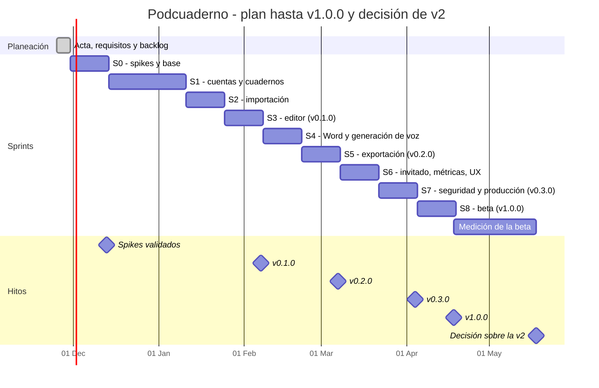

# Gestión de interesados y del proyecto

**Proyecto:** Podcuaderno
**Versión:** 0.5 (borrador)
**Fecha:** 26 de noviembre de 2026
**Autor:** Sebastián

---

## 1. Propósito

Este documento define quién tiene interés en el proyecto, cómo se comunica el avance y cómo se planea, controla y cierra el trabajo. Es proporcional a un proyecto de una persona: cada práctica se incluye solo si aporta.

## 2. Gestión de interesados

### 2.1 Registro de interesados

| ID | Interesado | Rol | Interés | Influencia | Expectativa principal |
|---|---|---|---|---|---|
| I-01 | Sebastián | Patrocinador, Product Owner y desarrollador | Alto | Alta | Un producto útil, una pieza fuerte de portafolio y, si hay demanda, ingresos. |
| I-02 | Estudiantes (usuarios gratuitos) | Usuarios | Alto | Media | Convertir sus apuntes en audio de forma fácil y gratuita, con sus datos protegidos. |
| I-03 | Usuarios de la beta (20 personas) | Probadores | Medio | Alta | Que su opinión se tenga en cuenta. Su comportamiento decide si se construye la v2. |
| I-04 | Suscriptores premium (v2) | Clientes | Alto | Alta | Voz natural, cobros claros y fáciles de cancelar. |
| I-05 | Reclutadores y empresas con trabajo remoto | Evaluadores del portafolio | Medio | Alta | Ver un producto en producción, código limpio y decisiones justificadas. |
| I-06 | Mentores o revisores externos | Revisores de código | Medio | Media | Pull requests pequeños y claros. |
| I-07 | Proveedor de hosting | Infraestructura | Bajo | Alta | Uso dentro del plan contratado. |
| I-08 | Microsoft (Azure AI Speech) y Mercado Pago (v2) | Proveedores | Bajo | Alta | Uso conforme a sus términos. |
| I-09 | Superintendencia de Industria y Comercio (SIC) | Autoridad de protección de datos | Bajo | Alta | Cumplimiento de la Ley 1581 de 2012. |
| I-10 | DIAN (v2) | Autoridad tributaria | Bajo | Alta | Facturación y tributación correctas por las suscripciones. |

### 2.2 Matriz poder / interés

| | Interés bajo | Interés alto |
|---|---|---|
| **Poder alto** | **Mantener satisfechos:** I-07, I-08, I-09, I-10. Cumplir términos, leyes y límites; revisar antes de cada versión. | **Gestionar de cerca:** I-01, I-03, I-04, I-05. Beta con seguimiento directo; README y producto pensados para I-05. |
| **Poder bajo** | **Monitorear:** sin interesados actualmente. | **Mantener informados:** I-02, I-06. Novedades en la aplicación y en las notas de versión. |

### 2.3 Plan de comunicación

| Qué | Para quién | Canal | Frecuencia | Responsable |
|---|---|---|---|---|
| Estado del backlog y del sprint | I-01 | GitHub Projects | Continuo | I-01 |
| Invitación, instrucciones y novedades de la beta | I-03 | Grupo de WhatsApp de la beta y correo | Semanal durante la beta | I-01 |
| Encuesta de la beta | I-03 | Formulario en línea | Al día 7 y al día 30 | I-01 |
| Reporte de errores y sugerencias | I-02, I-03 | Botón "Reportar un problema" en la aplicación | Cuando ocurra | Usuario |
| Notas de versión | I-02, I-05 | Página "Novedades" y GitHub Releases | Cada versión | I-01 |
| Solicitud de revisión | I-06 | Pull request | Por historia | I-01 |
| Presentación del proyecto | I-05 | README, demo en video y publicación en LinkedIn | Al lanzar la v1.0.0 | I-01 |
| Cambios en la política de datos | I-02, I-03 | Aviso en la aplicación y correo | Cuando cambie | I-01 |

## 3. Metodología de trabajo

**Scrumban adaptado a una sola persona:**

- **De Scrum:** sprints de 2 semanas con objetivo, planeación corta, revisión y retrospectiva escrita.
- **De Kanban:** tablero *Backlog · Listo · En progreso · En revisión · Hecho* con límite de **2 tareas en progreso**.
- **Lo que no se hace:** no hay Daily Scrum. Se reemplaza por una nota de 2 líneas en el issue activo al terminar cada sesión de trabajo: qué se hizo y qué sigue.

| Evento | Duración máxima | Resultado |
|---|---|---|
| Planeación del sprint | 30 min | Objetivo del sprint e historias en el tablero. |
| Revisión del sprint | 20 min | Video corto o capturas de lo construido; versión publicada si aplica. |
| Retrospectiva | 15 min | `docs/retros/sprint-N.md`: qué funcionó, qué no, qué cambiar. |
| Revisión de riesgos | 10 min | Registro de riesgos actualizado (dentro de la planeación). |

### 3.1 Flujo de trabajo en Git

- Monorepo con carpetas `frontend/`, `backend/` y `docs/`.
- Gitflow (ADR-0006): `main` (producción) y `develop` (integración). Ramas `feature/`, `docs/`, `chore/` y `ci/` desde `develop`, con slug en inglés (`feature/notebook-crud`), integradas por pull request con `--no-ff`. Ramas `release/x.y.z` y `hotfix/x.y.z` hacia `main`.
- Conventional Commits en inglés con ámbito (`feat(notebooks): ...`).
- `main` y `develop` protegidas. El despliegue a producción se hace al crear la etiqueta `vX.Y.Z` en `main` (versionado semántico).

## 4. Cronograma

Supuesto de capacidad: 6 a 8 horas por semana. El Sprint 1 dura 4 semanas por las festividades.

El detalle de historias por sprint está en el documento 03, sección 4.

## 5. Gestión de riesgos

Escala de 1 (bajo) a 3 (alto). Exposición = probabilidad × impacto.

| ID | Riesgo | P | I | Exp. | Respuesta | Disparador |
|---|---|---|---|---|---|---|
| R-01 | La voz en el navegador es demasiado lenta o de mala calidad en celulares. | 2 | 3 | 6 | **Mitigar:** spike HU-14 en el Sprint 0. **Contingencia:** recomendar generar desde computador, o mover la voz gratuita al servidor con un modelo de código abierto (aumenta el costo de hosting). | > 10 min para 20 000 caracteres en un celular de gama media. |
| R-02 | Los modelos de voz gratuitos no tienen licencia para uso comercial. | 2 | 3 | 6 | **Evitar:** revisar la licencia de cada modelo en el spike y llevar el inventario en `docs/licencias.md`. | Licencia "no comercial" o sin licencia clara. |
| R-03 | Falta de tiempo por trabajo y estudio. | 3 | 2 | 6 | **Mitigar:** límite WIP de 2, historias ≤ 8 puntos, orden de recorte definido. **Contingencia:** mover la v1.0.0 máximo 4 semanas. | Velocidad < 8 puntos dos sprints seguidos. |
| R-04 | La detección de temas falla con apuntes desordenados. | 3 | 2 | 6 | **Mitigar:** vista previa antes de guardar y editor completo (HU-11). | Usuarios de la beta reportan que tuvieron que reorganizar todo. |
| R-05 | Nadie usa la aplicación o nadie vuelve. | 2 | 2 | 4 | **Aceptar y aprender:** la beta existe para medirlo; el proyecto conserva su valor como portafolio. | No se cumple OE-5. |
| R-06 | Filtración de datos o acceso a cuadernos ajenos. | 1 | 3 | 3 | **Evitar:** control de acceso por dueño probado en cada endpoint, OWASP ZAP, SonarQube, escaneo de secretos. **Contingencia:** plan de respuesta a incidentes y aviso a los usuarios afectados. | Alerta de seguridad o reporte de un usuario. |
| R-07 | Incumplimiento de la Ley 1581 de 2012. | 1 | 3 | 3 | **Evitar:** política publicada, consentimiento registrado, eliminación de cuenta (HU-04, HU-05). | Revisión previa al lanzamiento. |
| R-08 | Safari en iPhone limita la memoria o las descargas y falla el armado del M4B. | 2 | 2 | 4 | **Mitigar:** spike HU-15 con un audiolibro de 60 minutos en iPhone. **Contingencia:** ofrecer MP3 por tema en iPhone. | Error de memoria en la prueba. |
| R-09 | Abuso: creación masiva de cuentas o archivos maliciosos. | 2 | 2 | 4 | **Mitigar:** verificación de correo, límite de peticiones, límites de tamaño y validación de archivos. | Picos anormales en el panel de métricas. |
| R-10 | El hosting supera el presupuesto de 10 USD al mes. | 2 | 1 | 2 | **Mitigar:** ADR de hosting en el Sprint 7 comparando opciones; voz gratuita sin carga en el servidor. | Factura > 10 USD. |
| R-11 | (v2) Obligaciones tributarias o contractuales de cobrar en Colombia. | 2 | 3 | 6 | **Evitar:** asesoría contable antes de construir la v2. | Inicio de la planeación de la v2. |
| R-12 | (v2) El costo de la voz premium supera el precio del plan. | 2 | 3 | 6 | **Mitigar:** definir límites con los datos reales de la beta y el precio oficial por carácter. | Margen negativo en la simulación de planes. |
| R-13 | El nombre "Podcuaderno" ya está registrado como marca o alguien registra el dominio antes. | 1 | 2 | 2 | **Mitigar:** consulta en la SIC y revisión de redes en el Sprint 0; comprar el dominio apenas se validen las pruebas de concepto. **Contingencia:** usar la segunda opción de nombre (Escuchapuntes). | Resultado positivo en la búsqueda de marcas. |

## 6. Control de cambios

1. Toda solicitud de cambio se registra como issue con la etiqueta `cambio`: qué cambia, por qué y qué requisitos afecta.
2. El Product Owner evalúa el impacto en alcance, fecha, costo y riesgos.
3. Si afecta un requisito **M**, la fecha de una versión o una decisión técnica, se registra un ADR en `docs/adr/` y se actualizan los documentos afectados con una nueva versión en su historial.
4. Los cambios menores (redacción, historias **C**) se aprueban directamente en el tablero.

**Ejemplo real:** la versión 0.2 de estos documentos se generó por un cambio de alcance aprobado el 25 de noviembre de 2026. El producto pasó de herramienta de línea de comandos para programadores a aplicación web para cualquier persona.

## 7. Gestión de la calidad

| Aspecto | Práctica | Herramientas |
|---|---|---|
| Backend | Pruebas unitarias y de integración con base de datos real en contenedor; estilo de código. | JUnit Jupiter 6, Mockito, Testcontainers, JaCoCo, Spotless |
| Frontend | Pruebas de componentes y de hooks clave; estilo de código. | Vitest, Testing Library, ESLint, Prettier |
| Extremo a extremo | Flujo principal: registrarse, importar, editar, generar y descargar. | Playwright |
| Calidad estática | Análisis en cada pull request. | SonarCloud |
| Seguridad | Escaneo dinámico antes de cada versión; dependencias y secretos. | OWASP ZAP, Dependabot, escaneo de secretos de GitHub |
| Usabilidad y accesibilidad | Prueba con 5 usuarios; auditoría automática. | Sesiones observadas, Lighthouse |

## 8. Gestión de costos

| Recurso | v1.0 | v2 |
|---|---|---|
| Voz | 0 USD (navegador) | Por carácter, según el precio oficial de Azure. |
| Hosting del backend y PostgreSQL | Dentro del tope de 10 USD al mes | Se recalcula según el uso. |
| Dominio | Dentro del tope de 10 USD al mes (prorrateado) | — |
| Correo transaccional (verificación y recuperación) | Plan gratuito de Resend por SMTP (ADR-0012) | Se recalcula. |
| GitHub (código, Actions, Projects) | 0 USD | 0 USD |
| Pagos | — | Comisión de Mercado Pago por transacción. |

**Control:** revisión mensual de la factura y alerta de presupuesto en el proveedor de hosting. Antes de la v2 se construye una hoja de cálculo de planes con costo por usuario, precio y margen, con los datos reales de la beta.

## 9. Métricas de seguimiento

| Métrica | Meta |
|---|---|
| Velocidad (puntos por sprint de 2 semanas) | 11 a 14 |
| Historias **M** terminadas al cierre de la v1.0 | 100 % |
| Cobertura de la lógica del backend | ≥ 80 % |
| Hallazgos críticos o altos de seguridad | 0 |
| Costo mensual de operación | ≤ 10 USD |
| Usuarios de la beta | 20 |
| Usuarios de la beta que generan un segundo audiolibro en 30 días | ≥ 30 % |
| Tiempo hasta el primer audiolibro (usuario nuevo) | < 5 minutos |

## 10. Cierre de la v1.0 y decisión sobre la v2

1. Verificar los criterios de aceptación del documento 02 y dejar la evidencia en el issue de cierre.
2. Medir la beta durante 30 días y redactar el informe con las métricas de OE-5 y los resultados de la encuesta.
3. Escribir `docs/lecciones-aprendidas.md`.
4. Actualizar el README con capturas, demo en video y enlace a la aplicación.
5. **Reunión de decisión (alrededor del 18 de mayo de 2027):** construir la v2, mejorar la v1.0, cambiar el enfoque o cerrar el proyecto como portafolio. La decisión y su justificación quedan en un ADR.

## Historial de versiones

| Versión | Fecha | Cambio |
|---|---|---|
| 0.1 | 25 de noviembre de 2026 | Gestión de la herramienta de línea de comandos. |
| 0.2 | 25 de noviembre de 2026 | Reescrito para la aplicación web freemium: nuevos interesados (usuarios, autoridades), riesgos, cronograma de 20 semanas y punto de decisión de la v2. |
| 0.3 | 26 de noviembre de 2026 | Nombre definitivo Podcuaderno y riesgo R-13 sobre la marca. |
| 0.4 | 26 de noviembre de 2026 | Flujo de trabajo Gitflow (ADR-0006); herramientas de calidad definidas (Spotless, SonarCloud). |
| 0.5 | 26 de noviembre de 2026 | Proveedor de correo transaccional: Resend por SMTP (ADR-0012). |
