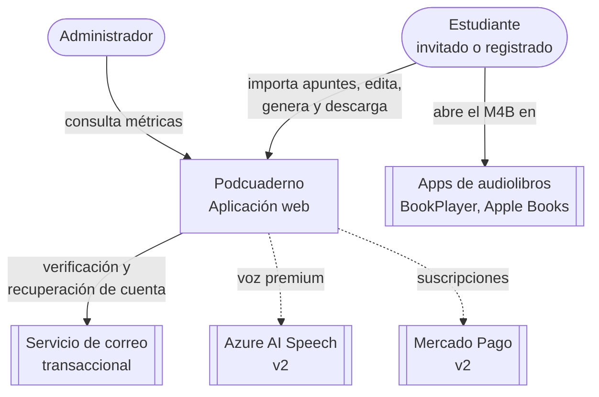
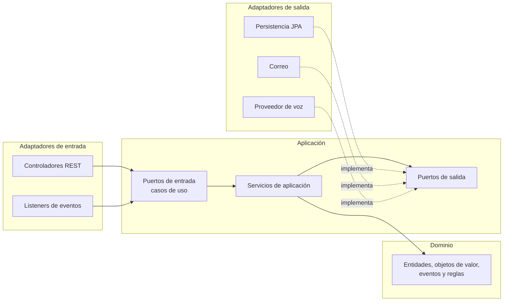
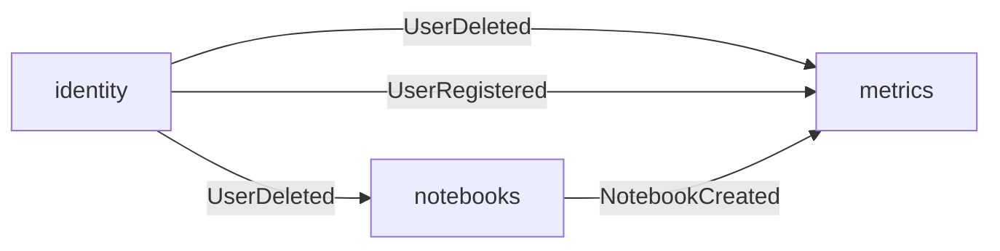
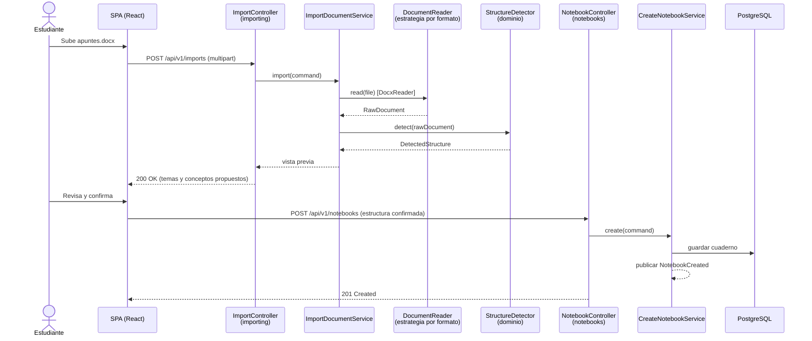

# Arquitectura y diseño

**Proyecto:** Podcuaderno
**Documento:** Arquitectura de software, diseño y estándares de código
**Versión:** 0.2 (borrador)
**Fecha:** 26 de noviembre de 2026
**Autor:** Sebastián

---

## 1. Propósito y principios

Este documento define cómo se construye Podcuaderno: la arquitectura, las reglas de dependencia, cómo se aplican SOLID y Clean Architecture, los estándares de código y cómo se verifica todo de forma automática.

**Principios rectores:**

1. **El negocio en el centro.** Las reglas de los cuadernos, temas y conceptos no dependen de Spring, de la base de datos ni de React.
2. **Las dependencias apuntan hacia adentro.** Lo técnico (web, base de datos, voz, correo) depende del negocio, nunca al revés.
3. **Límites claros entre módulos.** Cada módulo expone una API pública pequeña; lo demás es interno.
4. **Las reglas se verifican con pruebas, no con buena voluntad.** Si una regla de arquitectura se rompe, el pipeline falla.
5. **Pragmatismo.** Cada abstracción debe resolver un problema real: cambiar de proveedor, probar sin infraestructura o aislar un módulo. Se evita la arquitectura por moda (sección 12).

## 2. Vista de contexto (C4, nivel 1)



## 3. Vista de contenedores (C4, nivel 2)

| Contenedor | Tecnología | Responsabilidad |
|---|---|---|
| SPA | React + TypeScript + Vite | Interfaz, editor, generación de voz gratuita y armado del audiolibro en el navegador. |
| Motor de audio | WebAssembly dentro de un Web Worker | Sintetizar voz y armar el M4B sin bloquear la interfaz. |
| Caché local | IndexedDB | Audios ya generados y cuadernos del modo invitado. |
| API | Java 25 + Spring Boot 4 (monolito modular) | Cuentas, cuadernos, importación, métricas; en la v2, voz premium y suscripciones. |
| Base de datos | PostgreSQL | Datos de usuarios, cuadernos y eventos de uso. |

El diagrama de contenedores está en el documento 02, sección 3.2.

## 4. Estilo arquitectónico

**Monolito modular** (ADR-0001) en el que **cada módulo aplica Clean Architecture implementada con puertos y adaptadores** (ADR-0002).

- *Monolito modular:* un solo despliegue, pero dividido en módulos de negocio independientes, con límites verificados por Spring Modulith. Si algún día un módulo necesita escalar por separado (por ejemplo, la voz premium), se puede extraer como servicio sin reescribir el resto.
- *Clean Architecture con puertos y adaptadores:* dentro de cada módulo, el dominio y los casos de uso no conocen la tecnología. Se comunican con el exterior por **puertos** (interfaces) que implementan los **adaptadores**.



**Regla de dependencia:** Adaptadores → Aplicación → Dominio. El dominio no importa nada de las otras capas. Los adaptadores de salida implementan las interfaces que define la aplicación (inversión de dependencias).

## 5. Backend

### 5.1 Módulos

El código usa nombres en inglés (ADR-0005). La tabla relaciona cada módulo con el término del negocio.

| Módulo (código) | Negocio | Responsabilidad | Puede depender de |
|---|---|---|---|
| `identity` | Identidad | Registro, verificación, inicio de sesión, recuperación y eliminación de cuenta, consentimientos. | `shared` |
| `notebooks` | Cuadernos | Cuadernos, temas y conceptos; reglas de edición y de propiedad. | `shared` |
| `importing` | Importación | Leer TXT, Markdown y DOCX y detectar la estructura. No guarda nada: devuelve una vista previa. | `shared` |
| `metrics` | Métricas | Registrar eventos de uso agregados y calcular las métricas del panel. | `shared` |
| `shared` | Núcleo compartido | Tipos comunes (`UserId`, errores base), configuración de seguridad y manejo global de errores. | — |
| `premiumvoice` (v2) | Voz premium | Cola de trabajos y síntesis con el proveedor de voz. | `shared` |
| `subscriptions` (v2) | Suscripciones | Planes, pagos, límites de uso. | `shared` |

**Ningún módulo de negocio depende de otro.** Cuando uno necesita reaccionar a algo que pasa en otro, lo hace por **eventos de dominio** (ADR-0003):



Ejemplo: al eliminar una cuenta, `identity` publica `UserDeleted`. `notebooks` borra los cuadernos de ese usuario y `metrics` borra sus eventos, sin que `identity` sepa que esos módulos existen.

### 5.2 Estructura de paquetes de un módulo

```text
com.podcuaderno.notebooks
├── domain                         ← Java puro: sin Spring, sin JPA, sin Jackson
│   ├── model
│   │   ├── Notebook.java          (raíz del agregado)
│   │   ├── Topic.java
│   │   ├── Concept.java
│   │   ├── NotebookId.java        (objeto de valor, record)
│   │   └── Title.java             (objeto de valor con validación)
│   ├── event
│   │   └── NotebookCreated.java
│   └── exception
│       └── ConceptNotFoundException.java
├── application
│   ├── port
│   │   ├── in                     ← casos de uso (interfaces)
│   │   │   ├── CreateNotebookUseCase.java
│   │   │   └── MoveConceptUseCase.java
│   │   └── out                    ← lo que la aplicación necesita del exterior
│   │       ├── NotebookRepository.java
│   │       └── DomainEventPublisher.java
│   └── service                    ← implementación de los casos de uso
│       ├── CreateNotebookService.java
│       └── MoveConceptService.java
└── adapter
    ├── in
    │   ├── web                    ← controladores, DTO de petición y respuesta
    │   └── event                  ← listeners de eventos de otros módulos
    └── out
        └── persistence            ← entidades JPA, repositorios Spring Data, mappers
```

### 5.3 Responsabilidades y reglas por capa

| Capa | Contiene | Reglas |
|---|---|---|
| Dominio | Agregados, entidades, objetos de valor, eventos y excepciones de dominio. | Java puro. Protege sus invariantes: un objeto de dominio nunca queda en estado inválido. Sin getters/setters ciegos: métodos con intención (`moveConcept`, `rename`). |
| Aplicación | Casos de uso, puertos de entrada y de salida. | Orquesta: carga, invoca al dominio, guarda y publica eventos. Verifica la propiedad del recurso. Define el límite de la transacción (`@Transactional` se permite solo aquí). No contiene reglas de negocio. |
| Adaptadores de entrada | Controladores REST, DTO, listeners. | Traducen HTTP o eventos a llamadas de casos de uso. Validan formato (Bean Validation). Sin lógica de negocio. |
| Adaptadores de salida | JPA, correo, proveedores externos. | Implementan los puertos de salida. Las entidades JPA son distintas de las de dominio y se convierten con mappers. |

### 5.4 Ejemplo completo: mover un concepto a otro tema

**Dominio:** la regla vive en el agregado.

```java
public class Notebook {
    private final NotebookId id;
    private final UserId owner;
    private final List<Topic> topics;

    public void moveConcept(ConceptId conceptId, TopicId targetTopicId, int position) {
        Topic source = topicContaining(conceptId);
        Topic target = topic(targetTopicId);
        Concept concept = source.remove(conceptId);
        target.insert(concept, position);   // Topic valida la posición y reordena
    }

    public boolean isOwnedBy(UserId userId) {
        return owner.equals(userId);
    }
    // ...
}
```

**Puerto de entrada** (lo que la aplicación ofrece):

```java
public interface MoveConceptUseCase {
    void move(MoveConceptCommand command);
}

public record MoveConceptCommand(UserId requester, NotebookId notebookId,
                                 ConceptId conceptId, TopicId targetTopicId, int position) {}
```

**Puerto de salida** (lo que la aplicación necesita):

```java
public interface NotebookRepository {
    Optional<Notebook> findById(NotebookId id);
    void save(Notebook notebook);
}
```

**Servicio de aplicación:** orquesta, sin reglas de negocio.

```java
@Service
@Transactional
class MoveConceptService implements MoveConceptUseCase {
    private final NotebookRepository notebooks;

    MoveConceptService(NotebookRepository notebooks) {   // inyección por constructor
        this.notebooks = notebooks;
    }

    @Override
    public void move(MoveConceptCommand cmd) {
        Notebook notebook = notebooks.findById(cmd.notebookId())
                .filter(n -> n.isOwnedBy(cmd.requester()))
                .orElseThrow(() -> new NotebookNotFoundException(cmd.notebookId()));
        notebook.moveConcept(cmd.conceptId(), cmd.targetTopicId(), cmd.position());
        notebooks.save(notebook);
    }
}
```

Si el cuaderno es de otro usuario, se responde igual que si no existiera (404), para no revelar que existe.

**Adaptador de entrada:**

```java
@RestController
@RequestMapping("/api/v1/notebooks/{notebookId}/concepts")
class ConceptController {
    private final MoveConceptUseCase moveConcept;

    @PatchMapping("/{conceptId}/position")
    ResponseEntity<Void> move(@PathVariable UUID notebookId, @PathVariable UUID conceptId,
                              @Valid @RequestBody MoveConceptRequest body,
                              @AuthenticationPrincipal AuthenticatedUser user) {
        moveConcept.move(body.toCommand(user.id(), notebookId, conceptId));
        return ResponseEntity.noContent().build();
    }
}
```

**Adaptador de salida:** implementa `NotebookRepository` con Spring Data JPA y convierte entre `NotebookJpaEntity` y `Notebook` con un mapper.

**Qué se gana:**
- El dominio se prueba con pruebas unitarias puras, en milisegundos y sin base de datos.
- El servicio se prueba con un repositorio falso en memoria.
- Cambiar JPA por otra tecnología solo toca el adaptador.

### 5.5 Flujo: importar apuntes y crear un cuaderno



El módulo `importing` no conoce a `notebooks`: devuelve una vista previa y es el frontend el que confirma la creación. Así cada módulo tiene una sola razón para cambiar.

### 5.6 Manejo de errores

- El dominio lanza excepciones con significado de negocio (`ConceptNotFoundException`, `InvalidTitleException`).
- Un único `@RestControllerAdvice` en `shared` las traduce a respuestas con formato **Problem Details** (RFC 9457), que Spring soporta con `ProblemDetail`.
- Nunca se devuelven trazas de error ni mensajes internos al cliente.

| Situación | Código HTTP | Tipo (`type`) |
|---|---|---|
| Datos con formato inválido | 400 | `/errors/validation` |
| No autenticado o token vencido | 401 | `/errors/unauthenticated` |
| Recurso inexistente o de otro usuario | 404 | `/errors/not-found` |
| Regla de negocio violada (por ejemplo, posición inválida) | 422 | `/errors/business-rule` |
| Demasiadas peticiones | 429 | `/errors/rate-limit` |
| Error inesperado | 500 | `/errors/internal` (se registra con un ID de correlación) |

El `title` y el `detail` de los Problem Details van en inglés porque los consume el frontend; la interfaz muestra al usuario un mensaje en español según el `type`.

### 5.7 Validación en tres niveles

1. **Formato** (adaptador de entrada): Bean Validation en los DTO (`@NotBlank`, `@Size`).
2. **Reglas de negocio** (dominio): los objetos de valor y agregados validan sus invariantes al crearse y al cambiar.
3. **Autorización** (aplicación): cada caso de uso verifica que el usuario sea dueño del recurso.

### 5.8 Seguridad

- Spring Security vive en `shared` (adaptador). Los casos de uso reciben un `UserId`, nunca objetos de Spring Security.
- JWT de acceso de corta duración y refresh token en cookie `HttpOnly` (ver RNF-01 en el documento 02).
- Los logs nunca incluyen contraseñas, tokens ni contenido de los apuntes.

### 5.9 Persistencia

- PostgreSQL con migraciones versionadas en **Flyway**; nunca `ddl-auto=update` fuera de las pruebas.
- Identificadores UUID generados por la aplicación, no por la base de datos, para que el dominio pueda crearlos.
- Entidades JPA separadas del dominio (costo aceptado en ADR-0002).
- Las consultas de listas usan proyecciones y `JOIN FETCH` cuando hace falta, para evitar el problema N+1.

## 6. Frontend

### 6.1 Estructura por funcionalidades

```text
frontend/src
├── app/                    ← enrutamiento, proveedores globales, layout
├── features/               ← una carpeta por funcionalidad de negocio
│   ├── auth/
│   ├── notebooks/
│   ├── editor/
│   ├── import/
│   ├── generation/
│   └── admin/
│       └── (cada una con) components/  hooks/  api/  model/
├── core/                   ← lógica sin React, independiente de la interfaz
│   ├── audio/
│   │   ├── ports/          ← VoiceEngine, AudiobookAssembler (interfaces)
│   │   ├── adapters/       ← implementación WebAssembly, Web Worker
│   │   └── services/       ← GenerateAudiobook (caso de uso del navegador)
│   ├── storage/            ← IndexedDB detrás de una interfaz
│   └── http/               ← cliente HTTP, renovación de tokens, errores
└── shared/                 ← componentes de interfaz genéricos, utilidades
```

### 6.2 Reglas del frontend

1. **Los componentes no llaman a `fetch`.** Usan hooks, que usan la capa `api/`.
2. **`core/` no importa React.** Es TypeScript puro y se prueba sin navegador.
3. **Una funcionalidad no importa los archivos internos de otra.** Cada una expone su API en un `index.ts`.
4. **La voz y el armado del audio corren en un Web Worker**, para que la interfaz no se congele mientras se procesa (el hilo principal y el event loop quedan libres).
5. **Estado del servidor con TanStack Query** (caché, reintentos, sincronización). Estado local con el estado de React; se agrega una librería global solo si hace falta.
6. **Formularios con React Hook Form y validación con Zod**, con los mismos límites que el backend.

### 6.3 Ejemplo: inversión de dependencias en el motor de voz

```ts
// core/audio/ports/VoiceEngine.ts
export interface VoiceEngine {
  listVoices(): Promise<Voice[]>;
  synthesize(text: string, options: VoiceOptions): Promise<AudioClip>;
}

// core/audio/services/GenerateAudiobook.ts
export class GenerateAudiobook {
  constructor(
    private readonly voice: VoiceEngine,          // no sabe qué motor es
    private readonly cache: AudioCache,
    private readonly assembler: AudiobookAssembler,
  ) {}

  async execute(notebook: NotebookForAudio, onProgress: ProgressListener): Promise<Audiobook> {
    // por cada concepto: buscar en caché o sintetizar; luego armar el M4B
  }
}
```

La v1.0 usa un adaptador de voz en WebAssembly. En la v2, un `PremiumVoiceEngine` llama a la API del servidor e implementa la misma interfaz. `GenerateAudiobook` no cambia.

## 7. SOLID aplicado en este proyecto

| Principio | Dónde y cómo se aplica |
|---|---|
| **S** · Responsabilidad única | Un servicio por caso de uso (`MoveConceptService`, `CreateNotebookService`). `importing` solo lee y detecta; no guarda. El controlador solo traduce HTTP. |
| **O** · Abierto/Cerrado | Los lectores de documentos implementan `DocumentReader`. Agregar PDF en la v3 es crear `PdfReader`; no se modifica nada existente. Igual con los motores de voz. |
| **L** · Sustitución de Liskov | Todo adaptador de un puerto cumple el mismo contrato: el repositorio en memoria de las pruebas y el de JPA son intercambiables. Las pruebas de contrato del puerto corren contra ambos. |
| **I** · Segregación de interfaces | Puertos pequeños y por necesidad: `LoadNotebookPort` y `SaveNotebookPort` pueden separarse si un caso de uso solo lee. Los casos de uso tienen interfaces propias, no una interfaz gigante `NotebookService`. |
| **D** · Inversión de dependencias | La aplicación define `NotebookRepository`, `EmailSender`, `TokenIssuer`, `VoiceEngine`; la infraestructura los implementa. Inyección por constructor en todo el código, sin `@Autowired` en atributos. |

## 8. Patrones de diseño usados

| Patrón | Dónde | Para qué |
|---|---|---|
| Repository | `NotebookRepository`, `UserRepository` | Aislar el negocio de la base de datos. |
| Adapter | Adaptadores JPA, de correo, de voz y de pagos | Conectar tecnologías externas con los puertos. |
| Strategy | `DocumentReader` (TXT, MD, DOCX) y `VoiceEngine` | Cambiar el algoritmo según el formato o el plan. |
| Factory | `DocumentReaderFactory` | Elegir el lector según el tipo de archivo. |
| Observer (eventos de dominio) | `UserDeleted`, `NotebookCreated` | Comunicar módulos sin acoplarlos. |
| Aggregate y Value Object (DDD) | `Notebook`, `Title`, `NotebookId` | Proteger las reglas del negocio. |
| DTO | Peticiones y respuestas REST | No exponer el dominio en la API. |
| Builder (pruebas) | Constructores de datos de prueba | Pruebas legibles. |

## 9. Estándares de código y buenas prácticas

### 9.1 Generales

- **Idioma:** código, nombres y mensajes de commit en inglés; documentación y textos de la interfaz en español (ADR-0005).
- **Nombres que expliquen la intención:** `calculateRemainingCharacters`, no `calc`; nada de abreviaturas ni de nombres como `data`, `info` o `manager`.
- **Funciones cortas que hagan una sola cosa.** Guía: menos de 20 líneas; si se pasa, se revisa en el code review.
- **Sin números ni textos mágicos:** constantes con nombre o configuración.
- **Comentarios solo para explicar el porqué**, no el qué. Javadoc y TSDoc solo en las APIs públicas de los módulos.
- **Inmutabilidad por defecto:** `record` y campos `final` en Java; `const` y `readonly` en TypeScript.
- **Sin `null` en las APIs del dominio:** `Optional` en los retornos que pueden no tener valor.
- **Formato automático:** Spotless (Java) y Prettier (TypeScript), aplicados en el pipeline. No se discute el formato en las revisiones.
- **Boy Scout Rule:** deja el código un poco mejor de como lo encontraste.

### 9.2 Git y revisión

- Flujo Gitflow (ADR-0006): ramas `feature/`, `docs/`, `chore/` y `ci/` desde `develop`; `release/` y `hotfix/` hacia `main`.
- Conventional Commits: `feat(notebooks): allow moving concepts between topics`.
- Pull requests pequeños (idealmente menos de 400 líneas cambiadas) y enlazados a su historia.
- **Checklist del pull request:**
  - [ ] Cumple los criterios de aceptación de la historia.
  - [ ] Las pruebas cubren los casos normales y los de error.
  - [ ] Respeta la regla de dependencia (lo verifica el pipeline).
  - [ ] No hay lógica de negocio en controladores, componentes ni adaptadores.
  - [ ] No hay secretos, datos personales ni contenido de apuntes en los logs.
  - [ ] La documentación afectada está actualizada.

## 10. Estrategia de pruebas por capa

| Capa | Tipo de prueba | Herramientas | Qué se busca |
|---|---|---|---|
| Dominio | Unitarias puras | JUnit Jupiter 6, AssertJ | Reglas e invariantes. Cobertura objetivo ≥ 90 %. |
| Aplicación | Unitarias con dobles de los puertos | JUnit Jupiter 6, Mockito o implementaciones en memoria | Orquestación, permisos, eventos publicados. |
| Adaptadores web | De rebanada | `@WebMvcTest` | Rutas, validación, códigos HTTP, formato de errores. |
| Adaptadores de persistencia | De integración | Testcontainers con PostgreSQL real | Mapeos, consultas, migraciones. |
| Módulos | De módulo | `@ApplicationModuleTest` (Spring Modulith) | Que cada módulo arranque aislado y que publique o reciba sus eventos. |
| Arquitectura | De arquitectura | ArchUnit, Spring Modulith | Reglas de dependencia y límites entre módulos. |
| Frontend `core/` | Unitarias | Vitest | Lógica del audio y de la caché, sin navegador. |
| Frontend componentes | De componentes | Vitest + Testing Library | Comportamiento visible para el usuario. |
| Sistema | Extremo a extremo | Playwright | Flujo completo: registrarse, importar, editar, generar y descargar. |

## 11. Verificación automática de la arquitectura

Las reglas se ejecutan como pruebas en cada pull request (ADR-0004).

**Límites entre módulos** con Spring Modulith:

```java
class ModularityTests {
    @Test
    void modulesRespectTheirBoundaries() {
        ApplicationModules.of(PodcuadernoApplication.class).verify();
    }
}
```

Verifica que no haya ciclos entre módulos y que ningún módulo use clases internas de otro.

**Regla de dependencia dentro de cada módulo** con ArchUnit:

```java
@AnalyzeClasses(packages = "com.podcuaderno")
class CleanArchitectureTests {

    @ArchTest
    static final ArchRule domainIsFrameworkFree = noClasses()
            .that().resideInAPackage("..domain..")
            .should().dependOnClassesThat().resideInAnyPackage(
                    "org.springframework..", "jakarta.persistence..", "com.fasterxml..", "tools.jackson..");

    @ArchTest
    static final ArchRule cleanLayers = onionArchitecture()
            .domainModels("..domain..")
            .applicationServices("..application..")
            .adapter("web", "..adapter.in.web..")
            .adapter("events", "..adapter.in.event..")
            .adapter("persistence", "..adapter.out.persistence..");

    @ArchTest
    static final ArchRule noFieldInjection = noFields()
            .should().beAnnotatedWith("org.springframework.beans.factory.annotation.Autowired");
}
```

Configuración de Spring Modulith (ADR-0008): `shared` es un módulo abierto (`OPEN`) que consumen todos los módulos; los eventos de dominio se exponen como la interfaz nombrada `events` (`<módulo>.domain.event`); y las reglas de ArchUnit toleran los paquetes vacíos (`withOptionalLayers(true)` y `allowEmptyShould(true)`), para que la estructura se pueda crear de forma incremental.

**Convenciones de nombres verificadas** (ArchUnit):

| Elemento | Convención |
|---|---|
| Puerto de entrada | Interfaz `*UseCase` en `application.port.in` |
| Comando | Record `*Command` en `application.port.in` |
| Servicio de aplicación | Clase `*Service` en `application.service` que implementa un `*UseCase`; único lugar con `@Transactional` |
| Puerto de persistencia | Interfaz `*Repository` en `application.port.out` |
| Controlador | `*Controller` con `@RestController` en `adapter.in.web` |
| Listener | `*Listener` en `adapter.in.event` |
| Entidad JPA | `*JpaEntity` con `@Entity` en `adapter.out.persistence` |
| Repositorio Spring Data | `*JpaRepository` en `adapter.out.persistence` |
| Mapper | `*Mapper` en un paquete `adapter` |
| Excepción | `*Exception` que extiende `RuntimeException`; las de dominio viven en `domain.exception` y extienden `DomainException` de `shared` |
| Evento de dominio | Record en `domain.event` |
| Identificador | Record `*Id` en `domain` |

**Reglas de dependencia adicionales:**

- la aplicación no depende de web, persistencia ni Security;
- `@Transactional` solo va en `application.service`;
- `shared` no depende de los módulos de negocio;
- no se usan `System.out` ni `java.util.logging`.

**Frontend:** reglas de importación con ESLint (`no-restricted-imports` o `eslint-plugin-boundaries`): `core/` no puede importar React ni `features/`, y una funcionalidad solo puede importar el `index.ts` de otra.

## 12. Lo que NO se hace (para no caer en sobreingeniería)

- **No microservicios.** Un desarrollador y un solo despliegue (ADR-0001).
- **No CQRS ni Event Sourcing.** No hay un problema que lo justifique.
- **No interfaces para todo.** Solo para puertos (límites con el exterior) y casos de uso. Una clase de dominio o un mapper no llevan interfaz.
- **No capas vacías.** Si un caso de uso es una lectura simple, se permite que el servicio consulte el puerto y devuelva una proyección, sin pasar por el agregado completo.
- **No librerías de mapeo "mágicas" al inicio.** Mappers escritos a mano y probados; se reconsidera MapStruct si los mappers se vuelven repetitivos.
- **No optimizar antes de medir.** El rendimiento se mejora con datos de k6 y de producción.

## 13. Lenguaje ubicuo

| Negocio (español) | Código (inglés) |
|---|---|
| Cuaderno | `Notebook` |
| Tema | `Topic` |
| Concepto | `Concept` |
| Texto para audio | `spokenText` |
| Usuario | `User` |
| Consentimiento | `Consent` |
| Evento de uso | `UsageEvent` |
| Importación / vista previa | `Import` / `ImportPreview` |
| Audiolibro | `Audiobook` |
| Voz gratuita / premium | `BrowserVoiceEngine` / `PremiumVoiceEngine` |

## 14. Decisiones de arquitectura registradas

| ADR | Decisión |
|---|---|
| [ADR-0001](adr/0001-monolito-modular.md) | Monolito modular en lugar de microservicios. |
| [ADR-0002](adr/0002-clean-architecture-puertos-adaptadores.md) | Clean Architecture con puertos y adaptadores en cada módulo. |
| [ADR-0003](adr/0003-comunicacion-entre-modulos.md) | Comunicación entre módulos por eventos de dominio. |
| [ADR-0004](adr/0004-verificacion-automatica-arquitectura.md) | Verificación automática con ArchUnit y Spring Modulith. |
| [ADR-0005](adr/0005-idioma-del-codigo.md) | Código en inglés, documentación en español. |
| [ADR-0006](adr/0006-flujo-de-trabajo-gitflow.md) | Flujo de trabajo Gitflow con `main` y `develop`. |
| [ADR-0007](adr/0007-gradle-kotlin-dsl.md) | Gradle con Kotlin DSL para el backend. |
| [ADR-0008](adr/0008-configuracion-spring-modulith.md) | Configuración de Spring Modulith: `shared` abierto, eventos como interfaz nombrada y registro de publicaciones con JPA. |

Las decisiones pendientes (voz en el navegador, armado del M4B, hosting, licencia del código) se registrarán como ADR-0009 en adelante.

## Historial de versiones

| Versión | Fecha | Cambio |
|---|---|---|
| 0.1 | 26 de noviembre de 2026 | Versión inicial. |
| 0.2 | 26 de noviembre de 2026 | Gitflow, Gradle y configuración de Modulith (ADR-0006 a ADR-0008); convenciones de nombres verificadas; JUnit Jupiter 6. |
